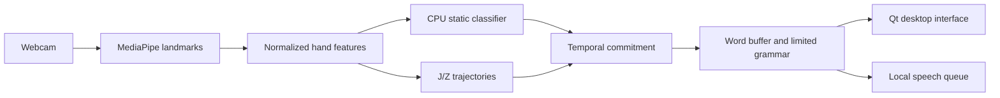

# SignBridge

**A local desktop tutor for fingerspelling and a limited ASL vocabulary.**

SignBridge connects webcam hand landmarks, a small CPU classifier, temporal gesture commitment, a word buffer, and a Qt interface. It includes data collection and training tools, motion handling for J/Z, a scripted replay mode, and an experimental FPGA interface.

## Architecture



## What is included

- Python/PySide6 application and named-camera selection.
- NumPy static classifier, session-aware training, evaluation, and model versioning.
- Letter dwell/release logic, repeated-letter handling, spacing, and motion calibration.
- Automated checks for the recognition pipeline, camera behavior, UI state, and training tools.
- An isolated host protocol and quantized oracle for future FPGA work.

## Run locally

On Windows, use CPython 3.11 or 3.12 with desktop/camera drivers:

```powershell
git clone https://github.com/Iwetter/SignBridge.git
cd SignBridge
./scripts/setup.ps1 -Python python
./.venv/Scripts/python.exe app.py
```

The setup script downloads the separate MediaPipe landmark model from its documented source. Choose a camera in the application. Use the dataset controls to collect your own examples and train supported static letters. Synthetic replay exercises the software pipeline without establishing webcam recognition accuracy.

```powershell
./.venv/Scripts/python.exe -m pytest -q
./.venv/Scripts/python.exe -m training.train --ready-only
./.venv/Scripts/python.exe -m training.evaluate --split new
```

## Status and scope

The local development version used a 24-class static alphabet model; J/Z use a separate motion path. This public source package excludes personal landmark recordings, camera identifiers, trained personal models, and model history. A fresh clone requires collection/training for live classification.

Continuous webcam acceptance and generalization to other signers remain open. The application handles a limited vocabulary and fingerspelling; unrestricted ASL translation is outside its implemented scope. FPGA RTL/board integration and physical acceleration benchmarks are incomplete.

See [`docs/architecture.md`](docs/architecture.md), [`docs/continuous-fingerspelling.md`](docs/continuous-fingerspelling.md), and [`docs/interface-contract.md`](docs/interface-contract.md). Some development notes describe the original local configuration; the public package contents and setup above take precedence.

**Tools:** Python · NumPy · OpenCV · MediaPipe · PySide6 · pytest

[Ian Hall's engineering portfolio](https://github.com/Iwetter)
